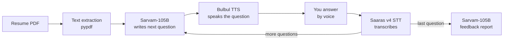

<div align="center">

# 🎙️ Mock Interviewer

**Practise interviews out loud, with questions built from your own resume.**

Upload your resume, get interviewed by voice in an Indian-English or Hindi voice, and receive a detailed feedback report. Built for the **Sarvam AI Buildathon** with Sarvam's speech and language models.

[](https://sarvammockinterviewer-fapappjdxskyt4v795crvwc.streamlit.app/)

**🔗 Live demo:** LIVE_DEMO_URL

</div>

<!-- Add a screenshot or GIF of the app here:

-->

## Why this exists

Most students practise interviews alone, with no real feedback, or with generic question lists that have nothing to do with their own projects. Mock Interviewer reads your actual resume, asks about *your* projects and skills, listens to your spoken answers, probes weak ones with follow-ups, and tells you exactly what to improve.

## Features

- **Resume-aware questions:** upload a PDF resume and get questions on your own projects, skills and experience for the role you are targeting.
- **Voice in, voice out:** questions are spoken aloud, and you answer with your microphone. A typed-answer box is there as a backup.
- **Adaptive follow-ups:** each new question takes your previous answers into account and digs deeper when an answer was vague.
- **Configurable session:** choose the target role, the number of questions and the interviewer's voice language.
- **Feedback report:** an overall score, strengths, areas to improve, a critique of every answer, resume tips and topics to revise. You can download it as a file.
- **Full transcript:** review every question and answer after the interview.

## How it works



| Step | Sarvam model | Purpose |
|---|---|---|
| Listen | **Saaras v4** (`saaras:v4`) | Speech-to-text, with the spoken language detected automatically |
| Think | **Sarvam-105B** (`sarvam-105b`) | Generates questions and follow-ups from the resume, and writes the final report |
| Speak | **Bulbul v4 Flash** (`bulbul:v4-flash`) | Text-to-speech for English questions. Hindi uses Bulbul v3, which is also the automatic fallback |

## Tech stack

Python · Streamlit · pypdf · Sarvam AI APIs (Saaras, Sarvam-105B, Bulbul)

## Project structure

```
mock-interviewer/
├── app.py              # Streamlit UI and interview flow
├── interviewer.py      # Prompts and logic for questions and the final report
├── sarvam_client.py    # Wrappers for the Sarvam speech-to-text, LLM and text-to-speech APIs
├── resume.py           # PDF resume text extraction
├── requirements.txt
├── .env.example        # Template for your settings
└── README.md
```

## Run it locally

**1. Get a Sarvam API key** from [dashboard.sarvam.ai](https://dashboard.sarvam.ai).

**2. Clone and install**

```bash
git clone https://github.com/rishabht10/sarvam-mock-interveiwer.git
cd sarvam-mock-interveiwer
python -m pip install -r requirements.txt
```

**3. Add your key**

```bash
# macOS / Linux
cp .env.example .env

# Windows (Command Prompt)
copy .env.example .env
```

Open `.env` and set `SARVAM_API_KEY=your_real_key` (no quotes, no spaces around `=`).

**4. Start the app**

```bash
python -m streamlit run app.py
```

It opens at `http://localhost:8501`. Allow microphone access when your browser asks. If no key is found, the app shows a box where you can paste one for the session.

## Configuration

All settings are optional except the API key. Put them in `.env` locally, or in **Secrets** on Streamlit Community Cloud.

| Variable | Default | Description |
|---|---|---|
| `SARVAM_API_KEY` | none (required) | Your Sarvam API key |
| `SARVAM_STT_MODEL` | `saaras:v4` | Speech-to-text model |
| `SARVAM_LLM_MODEL` | `sarvam-105b` | Language model for questions and feedback |
| `SARVAM_TTS_MODEL` | `bulbul:v4-flash` | Primary text-to-speech model |
| `SARVAM_TTS_SPEAKER` | `simran_en_customer` | Primary voice |
| `SARVAM_TTS_FALLBACK_MODEL` | `bulbul:v3` | Used for Hindi and if the primary voice fails |
| `SARVAM_TTS_FALLBACK_SPEAKER` | `priya` | Fallback voice |

Model names change over time. If you see an error about a deprecated model, check [docs.sarvam.ai](https://docs.sarvam.ai) and update the matching variable.

## Deploy on Streamlit Community Cloud

1. Push this repo to GitHub (make sure `.env` is **not** committed).
2. On [share.streamlit.io](https://share.streamlit.io), create an app from the repo with `app.py` as the main file.
3. Under **Advanced settings → Secrets**, add:
   ```toml
   SARVAM_API_KEY = "your_real_key"
   ```
4. Deploy. Any `git push` to `main` redeploys automatically.

## Troubleshooting

| Problem | Fix |
|---|---|
| "API key not found" | Check that `.env` sits next to `app.py` and is saved as `.env` (not `.env.txt`), or paste the key into the box in the app |
| "Model ... has been deprecated" | Set `SARVAM_LLM_MODEL` (or the matching variable) to a current model from the Sarvam docs |
| "No text found in this PDF" | The PDF is probably a scan or photo. Use a text-based PDF |
| Microphone does nothing | Allow microphone access in the browser. You can still type your answers |

## Privacy

The app does not save resumes, recordings or transcripts. They live only in your browser session. To work, your resume text and answers are sent to Sarvam's APIs for processing, so review Sarvam's terms before using real personal data.

## Roadmap

- Paste a job description and generate questions against it
- Hindi interviews end to end (speak and listen in Hindi)
- Spoken feedback summary at the end
- Score tracking across sessions

## Author

Built by **Rishabh Tiwari** · [GitHub](https://github.com/rishabht10) · [LinkedIn](https://linkedin.com/in/rishabh-tiwari-011164408)
